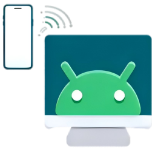

# scrcpy 便捷网页版

在浏览器里投屏并控制安卓手机：基于 **WebUSB + WebCodecs**，不装客户端，一条 USB 线或同一 Wi‑Fi 就能看到手机画面、用鼠标键盘直接操作。

<p align="left">
  
</p>

- 当前版本：**v4.0.12**
- 内核：scrcpy-server 5.0.1 · `@yume-chan/adb` / `@yume-chan/scrcpy`
- 平台：Windows 10 / 11，浏览器 Chrome / Edge 110+

> **非官方项目**：本项目是第三方网页端实现，不是 [scrcpy](https://github.com/Genymobile/scrcpy) 官方项目，与 Genymobile 无隶属或背书关系。第三方组件的版权与许可见 [THIRD-PARTY-NOTICES.md](THIRD-PARTY-NOTICES.md)。

## 功能特性

| 能力 | 说明 |
| --- | --- |
| USB 投屏 | 手机打开「USB 调试」后一键连接，复用本机官方 `adb.exe`，不弹 WebUSB 设备选择器 |
| 无线投屏 | USB 已连时一键 `adb tcpip 5555` 并读取手机 IP；同一 Wi‑Fi 下也支持自动搜索并连接 `IP:5555` |
| 画质调节 | 分辨率、FPS、码率、视频源、声音输出可调，选项自动保存，下次打开沿用 |
| 音频转发 | Android 13+ 支持「手机 + 电脑」双路出声；优先 raw PCM，不支持时走 Opus / AAC + WebCodecs |
| 操作控制 | 画布触控、滑动、滚轮；导航键、文本输入（中文选词后上屏）、退格/回车同步；剪贴板双向同步 |
| 截图 | 一键截取当前画面，保存到电脑「图片」目录 |
| 界面 | 侧边工具轨 + 抽屉式面板，支持全屏（H）、沉浸模式（I）、静音（M）、停止投屏（Shift+Esc） |
| 皮肤 | 内置 warm / mint / cobalt / graphite 四套配色，自定义主色与背景色，工具轨可左右切换 |

## 更新日志

### v4.0.12

- **读数条移入侧栏底部**：CH/ADB、RES/FPS、设备/声音、VIEW 四项读数不再叠加在手机画面上，统一收进左侧栏底部的半透明读数条；窄屏（≤760 px）自动改为底部工具轨上方的整宽横排，1366/1024/700 三档窗口实测与画面零重叠。
- **无线连接提速**：启动前的设备清理与看门狗布防各自合并为一次 shell 往返、并与 scrcpy 启动并行；`/api/wireless-push` 在手机端 jar 尺寸一致时跳过 700 KB 重传。实测热态二次连接 1.5 s、冷态首次 6.5 s。
- **ADB 握手超时**：默认 15 s → 30 s，给首次「允许 USB 调试」留出点击时间；排查时可用 `?auth_timeout=毫秒` 覆盖。连接失败时顶栏直接显示「连接失败」，不再停在「ADB 握手中…」。
- **手机端看门狗收敛**：无线会话失联即结束手机端 scrcpy、释放音频采集并退出；判据只剩「心跳过期 30 s」「Wi‑Fi IPv4 连续两次消失」「从未收到心跳满 60 s」三条，心跳/运行标记带会话号隔离，不会误杀新会话。实现细节见 `docs/watchdog.md`。
## 下载安装

不想配环境？直接下安装包：**[scrcpy-web-mirror-v4.0.12-Setup-x64.exe](https://github.com/1262717341/scrcpy-web-mirror/releases/latest)**（约 15 MB，内置 Python 运行时与官方 adb）。安装后双击桌面快捷方式启动，手机开「USB 调试」并连上电脑，点「开始 USB 投屏」即可。

## 从源码运行（开发者）

> 前置条件：Windows 10 / 11、Python 3.9+、Chrome 或 Edge 110+。仓库已带构建好的 `js/mirror.bundle.js`，不装 Node 也能直接跑。

```bash
git clone https://github.com/1262717341/scrcpy-web-mirror.git
cd scrcpy-web-mirror
```

1. **补齐 adb**：把官方 platform-tools 里的 `adb.exe`、`AdbWinApi.dll`、`AdbWinUsbApi.dll` 放进 `assets/adb/`（受体积限制未入库）。
2. **启动本地服务**：

   ```bash
   python serve.py
   ```

   然后浏览器打开 <http://127.0.0.1:8765/control.html>。端口可用环境变量 `PANDA_PORT` 覆盖。
3. **改前端时再构建**（可选）：

   ```bash
   npm install
   npm run build
   ```

> `start.vbs` 是安装包内的静默启动脚本，依赖同目录的 `runtime\pythonw.exe`（内置 Python 运行时）；源码环境用系统 Python 直接跑 `serve.py` 即可。

## 使用流程

1. 手机进入「开发者选项」→ 打开「USB 调试」，数据线连电脑。
2. 网页点「开始 USB 投屏」，手机上点「允许调试」。
3. 想无线用：USB 连着时点「开启无线调试」（等价 `adb tcpip 5555`），拔线后填手机 IP 连接；手机与电脑同一 Wi‑Fi 也可直接「自动搜索」。

**注意**：USB 与无线二选一，不要同时开。若提示端口/设备被占用，先关掉其它 adb、手机助手或其它投屏页面。

## 目录结构

```
.
├─ control.html          # 主界面（控制台/抽屉面板）
├─ index.html            # 入口跳转页
├─ serve.py              # 本地静态服务 + 设备侧接口（status/shutdown/usb-push/wireless-push/save-shot…）
├─ start.vbs             # 安装包使用的静默启动脚本
├─ build.mjs             # esbuild 打包脚本
├─ css/app.css           # 界面样式
├─ js/mirror.bundle.js   # 构建产物（已入库，开箱即用）
├─ src/
│  ├─ page-mirror.js     # 投屏主逻辑（WebUSB ADB · WebCodecs 解码）
│  ├─ mirror.js          # 投屏封装与设备会话
│  ├─ wireless.js        # 无线连接 / tcpip / 自动搜索
│  ├─ control.js         # 触摸、键盘、剪贴板、导航键
│  └─ audio.js           # PCM / Opus / AAC 音频转发
├─ assets/
│  ├─ scrcpy-server.jar  # scrcpy 服务端（5.0.1）
│  ├─ adb/               # 官方 adb（本地放置，未入库）
│  ├─ logo.png
│  └─ custom-icon.ico
└─ docs/compose/spec/    # UI v3 改版设计稿
```

## 工作原理

- 浏览器侧通过 `@yume-chan/adb` 走 **WebUSB** 直连手机 ADB，推送 `scrcpy-server.jar` 并建立视频/音频/控制三条通道。
- 视频流用 **WebCodecs** 硬解后绘制到 Canvas；音频优先 raw PCM，必要时 Opus/AAC 解码。
- 本地 `serve.py` 只做两件事：提供静态文件、代理需要真实 `adb.exe` 才能完成的操作（设备枚举、`tcpip`、推送 server、截图落盘等），并监听 `127.0.0.1`。
- 退出页面时调用 `/api/shutdown` 结束服务并清理残留的 `adb` / `scrcpy` 进程。

## 快捷键

| 按键 | 作用 |
| --- | --- |
| `H` | 全屏（隐藏侧栏，保留可拖动控制条） |
| `M` | 静音 / 恢复声音 |
| `I` | 沉浸模式（隐藏全部工具栏，`I` / `V` / `Esc` 恢复） |
| `Shift+Esc` | 停止投屏 |

## 常见问题

- **画面黑屏 / 浏览器黑屏**：关闭浏览器硬件加速后再试，或换 Chrome / Edge 最新版。
- **无线连不上**：确认同一 Wi‑Fi、手机已开无线调试、IP 正确；必要时先用 USB 执行一次 `adb tcpip 5555`。
- **没有声音**：Android 13 以下不转发音频（客户端会自动降级）；断开投屏后手机仍无声，按一次手机音量键或重连一次。
- **无线时手机锁屏变黑**：本版本不修改手机锁屏时间，请在手机「设置 → 显示 → 休眠」自行调整。
- **提示 adb 被占用**：关掉其它 adb 服务、手机助手、同类投屏页面后重试。

## 构建

```bash
npm install
npm run build     # esbuild 打包 src/page-mirror.js → js/mirror.bundle.js
```

## 来源、许可与致谢

本项目自身代码以 **Apache-2.0** 发布，见 [LICENSE](LICENSE)。

用到的第三方作品（完整清单、用途与许可全文见 [THIRD-PARTY-NOTICES.md](THIRD-PARTY-NOTICES.md)，原文在 `third_party/`）：

| 组件 | 用途 | 许可 | 版权 | 上游 |
| --- | --- | --- | --- | --- |
| scrcpy 5.0.1（`assets/scrcpy-server.jar`） | 手机端服务、投屏与控制协议 | Apache-2.0 | © Genymobile | [Genymobile/scrcpy](https://github.com/Genymobile/scrcpy) |
| @yume-chan/adb、scrcpy、pcm-player 等 13 个包 | 浏览器 ADB、scrcpy 协议、音频播放 | MIT | © 2020–2025 Simon Chan | [yume-chan/ya-webadb](https://github.com/yume-chan/ya-webadb) |
| tinyh264 | H.264 软件解码回落 | Apache-2.0 | © Erik De Rijcke | [aaaronic/tinyh264](https://github.com/aaaronic/tinyh264) |
| yuv-buffer / yuv-canvas | YUV 帧转换与 Canvas 绘制 | MIT | © 2014–2024 Brooke Vibber | [btlr/yuv-canvas](https://github.com/btlr/yuv-canvas) |
| esbuild | 打包 `js/mirror.bundle.js` | MIT | © 2020 Evan Wallace | [evanw/esbuild](https://github.com/evanw/esbuild) |
| Android platform-tools | 需自行放入 `assets/adb/`，不随仓库分发 | Apache-2.0 | © Google LLC | [developer.android.com](https://developer.android.com/tools/releases/platform-tools) |

`scrcpy`、`Android`、`Chrome`、`Edge`、`Windows` 等名称与商标归各自所有者。本项目与上述项目均无隶属关系，也不代表其官方立场。

## 免责声明

本项目仅用于调试**自己拥有或已获授权**的安卓设备。请遵守所在地法律法规及设备使用协议，勿用于未授权的监控或数据获取。
